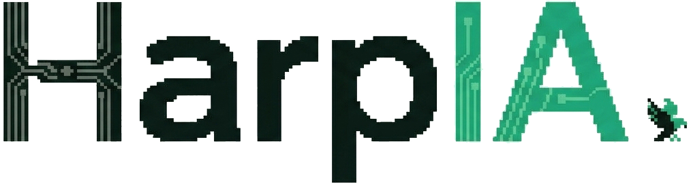

  
  <h1>HarpIA</h1>
  
<strong>Uma assistente local em português para aprender e explorar ideias.</strong>

## Sobre

A HarpIA é uma assistente de inteligência artificial executada localmente com [Ollama](https://ollama.com/) e o modelo [Mistral](https://mistral.ai/). Ela combina conversa com um motor de busca próprio (SQLite FTS5) sobre a base de conhecimento e os seus PDFs, e funciona totalmente offline.

## Recursos

- Conversa pelo terminal, sem interface web.
- Motor de busca local e persistente (SQLite FTS5 + BM25), com as fontes citadas no fim da resposta.
- Roteador de intenção: conversa casual e perguntas sobre a HarpIA não disparam busca.
- Conversas privadas por usuário e API protegida por credencial.
- Funciona offline: nenhuma API externa ou chave é necessária.
- Análise local de bases econômicas CSV, Excel e PDF com Pandas e NumPy.
- Leitura eficiente e fragmentação em chunks de PDFs com PyMuPDF (fitz) otimizada para baixo consumo de memória.

## Começar no Windows

Pré-requisitos: Python 3.11 ou posterior e [Ollama](https://ollama.com/download) instalados.

1. Abra `Iniciar-HarpIA.bat` com dois cliques.
2. Na primeira execução, aguarde a preparação do ambiente e do modelo; o download inicial pode demorar.
3. Faça uma pergunta no chat que será aberto no terminal.

Para analisar dados de um estabelecimento, envie uma planilha CSV, XLSX ou arquivo PDF com dados tabulares pelo comando `/importar "C:\\caminho\\da\\base.xlsx"` (ou `"base.pdf"`). Depois, pergunte sobre faturamento, custos, despesas, lucro ou tendências. Use `/bases` para ver os arquivos recebidos.

As bases ficam no computador, separadas por usuário, e não são incluídas no Git. A HarpIA envia somente resumos numéricos ao modelo local para explicar os resultados.

Para ampliar o que a HarpIA sabe, coloque arquivos `.txt` ou `.md` em `backend/knowledge_base/` (são indexados na próxima pergunta, apenas os novos ou alterados) ou importe PDFs pelo chat com `/documento` e `/importar`.

## Documentação

- [Guia de uso e primeiros passos](LEIA-ME.md)
- [Configuração, API e administração](backend/README.md)
